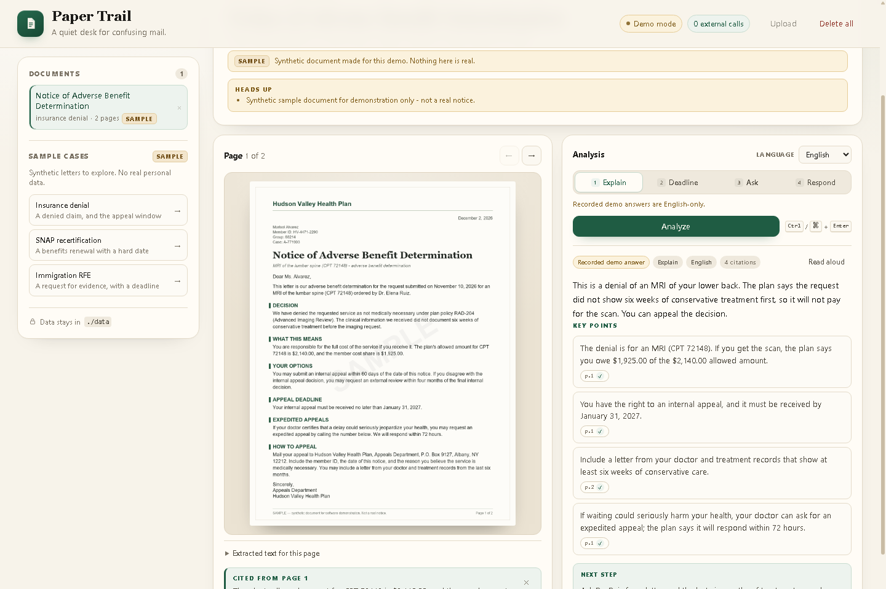

# Paper Trail

**Your paperwork, answered — privately.**

Paper Trail is a local-first document desk for the paper that runs your life: insurance denials,
benefits recertifications, immigration requests, bills, leases. Drop in a photo, PDF, or text file and
it will:

- **Explain** what the document is and what it wants from you, in plain language.
- **Extract deadlines** — every date that matters, what happens if you miss it, what to do.
- **Answer questions** using only the document, with page citations and an explicit "what this
  document does not say" field.
- **Draft the reply** — a ready-to-send letter, the documents to attach, and where to send it.

Every extracted fact carries a **page citation that the server re-checks against the page text**, and
the app shows you when a quote could not be verified. Documents stay in a local folder
(`paper-trail/data`). There is no telemetry, no account, and no cloud storage.

Built at **Hacktoberfest Hack Day — Astoria Tech Meetup × MLH, October 21, 2026**. Prototype reference:
the event's earlier `astoria-lens/` app (same zero-dependency style).



*Demo mode: the insurance-denial sample in Explain mode, with four page-verified citations. The
synthetic letter itself is at [samples/pages/benefits-denial/page-1.png](samples/pages/benefits-denial/page-1.png).*

---

## 60-second demo

```powershell
cd paper-trail
python server.py
# open http://127.0.0.1:8765
```

Click **Load sample case → Insurance denial**, then **Explain**. You get the denial, the money, the
Jan 31, 2027 appeal deadline, the records to attach, and the expedited-appeal option — each with a
clickable page citation. Flip to **Deadline**, **Ask** ("What do I need to do?"), **Respond** (a draft
appeal letter with a document checklist). Switch the language to Español and run **Explain** again.

**No API key? The demo still works.** With no key the app runs in **demo mode** and serves recorded
answers for the three bundled sample cases — fully offline, not a single network request. The UI
shows a `DEMO MODE` pill and the external-call counter stays at **0**.

**"Model reads, code checks."** The model is asked for JSON with verbatim quotes. The server then
normalizes each quote and looks for it in the stored page text, marking every citation
`verified: true/false/null`. Unverified claims are surfaced, not hidden. This is the difference
between a summary and something you can act on.

---

## Quickstart

Requirements: **Python 3.9+** (no `pip install`, no build step, no Node). The runtime server is
standard library only.

```powershell
cd paper-trail
$env:GEMINI_API_KEY="your-key"   # optional; from https://aistudio.google.com/apikey
python server.py                 # http://127.0.0.1:8765
```

```bash
# macOS / Linux
cd paper-trail
export GEMINI_API_KEY="your-key"
python3 server.py
```

Before demoing:

```powershell
python tools/selftest.py        # 90 offline end-to-end checks: mock API, no key, no network needed

# Live path only: start the server with a key in one shell, then check it from a second shell
$env:GEMINI_API_KEY="..."; python server.py
python tools/check_api.py       # one real Gemma 4 call: model, HTTP status, latency, first line
```

The app calls **`gemma-4-26b-a4b-it`** through the Gemini API by default. Without a key it runs in
demo mode (sample cases only, no network). Live analysis of your own uploads needs a key or a local
model (§ below).

### Upload

Drag a photo/PDF/TXT onto the window or use **Upload**. Accepted: PNG/JPG/WebP, PDF, TXT/MD.
Uploaded photos are transcribed once at ingest (for citation checking); PDFs get best-effort text
extraction; a scanned PDF with no text still analyzes from the page image but citations may be
unverifiable.

---

## Configuration

| Variable | Default | Meaning |
| --- | --- | --- |
| `PAPERTRAIL_PORT` | `8765` | HTTP port |
| `PAPERTRAIL_HOST` | `127.0.0.1` | bind host (keep it loopback) |
| `PAPERTRAIL_DATA_DIR` | `data` | local store: `docs.json` + page files |
| `PAPERTRAIL_DEMO` | unset | `1` forces demo mode, no model calls |
| `GEMINI_API_KEY` | unset | hosted Gemini API key (Gemma 4) |
| `PAPERTRAIL_MODEL` | `gemma-4-26b-a4b-it` | hosted model id |
| `PAPERTRAIL_API_BASE` | `https://generativelanguage.googleapis.com` | Gemini-compatible base URL |
| `PAPERTRAIL_MAX_FILE_MB` | `12` | per-file upload limit |
| `PAPERTRAIL_TRANSCRIBE` | `1` | transcribe uploaded page photos for citation checking |
| `PAPERTRAIL_BACKEND` | `gemini` | `gemini` or `openai` (local server) |
| `OPENAI_BASE_URL` | `http://127.0.0.1:11434/v1` | Ollama / LiteRT-LM / llama.cpp / LM Studio |
| `OPENAI_MODEL` | `gemma4:12b` | local model id |

Demo mode is active when `PAPERTRAIL_DEMO=1` **or** the Gemini backend has no API key.

---

## How Gemma 4 is used

| Piece | How |
| --- | --- |
| Model | `gemma-4-26b-a4b-it` (also works with `gemma-4-31b-it`; Apache 2.0 weights) |
| Vision | Page images are sent inline; the model reads printed letters, forms, and handwriting |
| Long context | Up to 10 pages per call, with page markers preserved so citations stay anchored |
| Structured output | Prompt contract returns one JSON object per mode (explain / deadline / ask / respond) |
| Thinking | `thinkingConfig.thinkingLevel = "minimal"` for low-latency document work |
| Languages | Answer in English, Spanish, Greek, Bengali, Chinese, Arabic; quotes stay in the original |
| No audio | The hosted Gemma 4 models are text + image only; Paper Trail makes no audio claims |

The prompts live in `server.py` (`SYSTEM_PROMPT`, `MODE_TASKS`). The reusable task contracts are
packaged as portable Markdown skills in [`skills/`](skills/SKILL.md) — including
`deadline-extractor`, `explain-notice`, `ask-with-citations`, and `appeal-drafter` — so the same logic
can be loaded by another agent harness (`SKILL.md` with YAML `name` + `description` is the convention).

---

## API now, local model later

The app is written so the hosted call is one adapter, not the architecture:

```
UI (static/) ── POST /api/analyze ── server.py ── ModelClient ──┬─ Gemini API (today)
                      │                                          └─ OpenAI-compatible local server (later)
                      ├─ local store: data/docs.json + page images
                      ├─ citation verification against page text
                      └─ JSON prompt contracts (skills/SKILL.md)
```

- **Today:** Gemini API `POST /v1beta/models/gemma-4-26b-a4b-it:generateContent`.
- **Later (laptop):** Gemma 4 **12B Unified** on a 16 GB machine via [LiteRT-LM](https://developers.google.com/edge/litert-lm) (`.litertlm`) or Ollama.
  Set `PAPERTRAIL_BACKEND=openai` and `OPENAI_BASE_URL=http://127.0.0.1:9379/v1` (LiteRT-LM `serve`)
  or `http://127.0.0.1:11434/v1` (Ollama); no code change.
- **Later (phone):** Gemma 4 **E2B/E4B** through LiteRT-LM / Android AICore (preview). Same
  `SKILL.md` contracts; the UI would become a companion client.
- **Retrieval:** a single document fits in context today; for a folder of documents, EmbeddingGemma 2
  (740M, multimodal, 8K context) is the intended local embedder.

The demo recordings in `samples/responses.json` are the "offline mode" proof: the exact same response
shape the live model produces, served with zero network calls.

---

## Privacy

Paper Trail is built around a simple rule: **the document stays on the machine it was opened on.**
No telemetry, no analytics, no accounts, no sync, no third-party scripts. Read [`PRIVACY.md`](PRIVACY.md)
for the full model, including the honest limits of hosted-API prototyping and local-file storage.

- No external requests from the UI; there are no CDNs or tracking scripts.
- The external-call counter in the UI comes from the server and is visible at all times.
- **Delete everything** removes the local index and every uploaded page file.
- Sample cases are synthetic and clearly marked; they are not real notices or advice.
- Free-tier Gemini API prompts may be human-reviewed and used to improve products — do not analyze
  other people's sensitive documents on a free tier. Paid tier or a local model is the answer for
  real paperwork.

---

## Tests

```powershell
python -m py_compile server.py
python tools/selftest.py      # starts a mock Gemini API + the app, checks ingest/analyze/citations/demo/errors
python tools/check_api.py     # live API smoke test (needs GEMINI_API_KEY)
node --check static/app.js    # if Node is available
```

`tools/mock_gemini.py` is the offline fake used by the test suite; it derives citation quotes from the
prompt so the server's verification path is exercised for real.

**Current status:** `selftest.py` passes **90/90** checks. The **live Gemma 4 path was verified end to
end** with a real key: `explain` returned 4/4 page-verified citations (~18–20 s on the free tier for
the 2-page sample), `ask` returned 5/5 verified citations (~7 s), and `tools/eval.py` matched **3/3**
sample documents on gold deadlines/amounts. The UI was rendered and driven in headless Chrome end to
end (sample auto-load → Explain → citation jump → Deadline), on desktop and mobile (390 px, no
horizontal overflow), with zero console errors and the external-call counter at **0** in demo mode.
Screenshots: [docs/screenshots/](docs/screenshots/).

---

## Repo layout

```
paper-trail/
├── server.py                 # stdlib HTTP server: API, store, model adapter, citation checks
├── static/                   # zero-build UI (HTML/CSS/JS), no external assets
├── samples/
│   ├── docs.json             # 3 synthetic sample cases with exact page text
│   ├── responses.json        # recorded demo-mode answers (English)
│   └── pages/                # rendered letter pages (generated by tools/make_samples.py)
├── skills/                   # portable SKILL.md contracts (root + 4 task skills)
├── docs/screenshots/         # UI screenshots (home, document, explain, deadline)
├── tools/
│   ├── make_samples.py       # regenerate sample letter pages (Pillow, build time only)
│   ├── mock_gemini.py        # offline fake Gemini endpoint for tests
│   ├── selftest.py           # end-to-end offline test suite
│   ├── check_api.py          # live API smoke test
│   └── eval.py               # optional live extraction eval (deadlines/amounts)
├── eval/gold.json            # gold expectations for the sample cases (optional eval)
├── data/                     # runtime local store (gitignored)
├── CONTRACT.md               # API / data / UI build contract
├── README.md · DEMO.md · PRIVACY.md
├── .env.example · .gitignore · LICENSE
```

---

## Honest limits

- **Not legal, medical, or immigration advice.** Paper Trail explains documents, extracts dates, and
  drafts replies; it is not a lawyer, doctor, or accredited representative. High-stakes decisions
  should go to a professional or a legal-aid organization.
- **Citations are verified, understanding is not guaranteed.** The server proves a quote appears in
  the page text; it cannot prove the model's interpretation is right. Read the cited passage.
- **Scanned PDFs** without a text layer are analyzed from page images; citations for them are marked
  unverified because there is no stored text to check. Upload photos of the pages for best results.
- **The hosted API is for prototyping.** Free-tier prompts may be used to improve products, rate
  limits apply, and only the 26B/31B Gemma 4 variants are hosted (no audio, no E2B/E4B/12B). The
  privacy promise becomes fully true with a local model.
- **Local storage is not encrypted by default.** Use full-disk encryption on the machine, and do not
  expose the server beyond `127.0.0.1`.
- **Small local models are weaker.** The 12B laptop model is good for extraction and grounded Q&A,
  not for open-ended reasoning; keep tasks scoped and citations on.

## License

MIT — see [LICENSE](LICENSE). Sample documents are synthetic. Gemma 4 weights are Apache 2.0.

Built for Hacktoberfest Hack Day Astoria, October 21, 2026.
